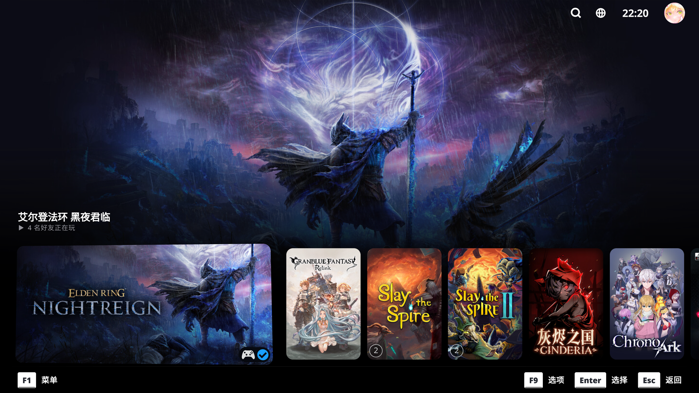
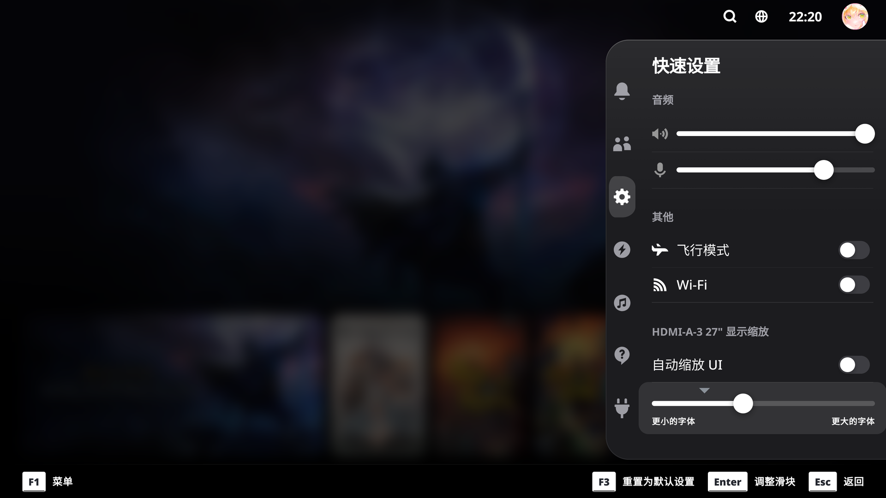
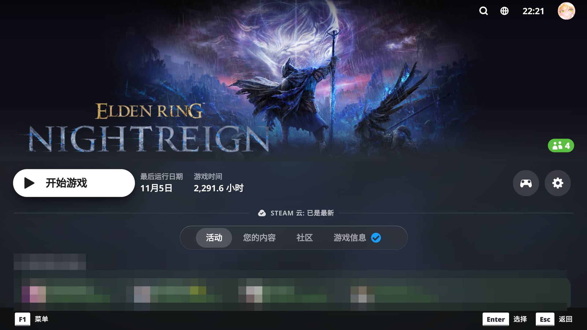

# tvdeck

Apple TV / tvOS look for SteamOS Game Mode – Steam Machine (16:9, 4K), Steam Deck and Big Picture.
A theme for CSS Loader (Decky Loader).

Based on [**tvOS Deck**](https://github.com/zoyekerako/tvos-deck) by **K€YOZ** (MIT).

[简体中文说明](README.zh-CN.md)

## Screenshots

## Install

1. Install [Decky Loader](https://decky.xyz) and the **CSS Loader** plugin.
2. Copy this folder to `~/homebrew/themes/tvdeck` (or install “tvdeck” from CSS Loader's theme browser).
3. Quick Access (…) → CSS Loader → enable **tvdeck**.
4. Recommended: Steam *Settings → Customization → Home → Big Art Mode* for the Apple TV Top Shelf layout.

The folder name must stay `tvdeck`: CSS Loader serves theme files by folder name.

## Options

| Option | Values | Default |
| --- | --- | --- |
| Focus Effect | Apple TV (Parallax) · Subtle · Off | Apple TV (Parallax) |
| Background | Graphite · Black (OLED) · Aurora (tvOS 26) | Graphite |
| Font | Steam (Motiva Sans) · System font | System font |
| Footer | Steam Default · Minimal · Hidden | Steam Default |
| Keyboard Styling | Yes · No | Yes |
| Reduce Transparency | Yes · No | No |
| Colors | Accent color, toggle color | `#0A84FF` / `#30D158` |
| Hide friends playing | Yes · No | Yes |
| Recent Games At Bottom | Yes · No | Yes |
| Fullscreen Recent Games Background | Yes · No | No |
| Titles Above Cards | Yes · No | Yes |

## Notes

- `Titles Above Cards` moves the focused game's label above the recent-games row and hides the "Recent Games" header;
  with `Recent Games At Bottom` the row stays docked at the bottom and the label follows it upwards.
- The Steam menu and Quick Access are separate overlay windows and cannot blur the game behind them, so they use
  opaque glass.
- The theme ships no font files. `System font` resolves to `system-ui, sans-serif`; `Steam (Motiva Sans)` keeps
  Steam's own font stack.
- Unofficial fan theme, not affiliated with Apple or Valve.

## Credits

tvdeck is derived from [**tvOS Deck**](https://github.com/zoyekerako/tvos-deck) by **K€YOZ** (upstream version 1.1.0, MIT licence). The original
copyright line is retained in [LICENSE](LICENSE); modifications are by Honchane.

## Deutsch

Ordner nach `~/homebrew/themes/tvdeck` kopieren, in CSS Loader einschalten und in Steam
*Einstellungen → Anpassung → Startseite → „Große Grafik“* aktivieren.
