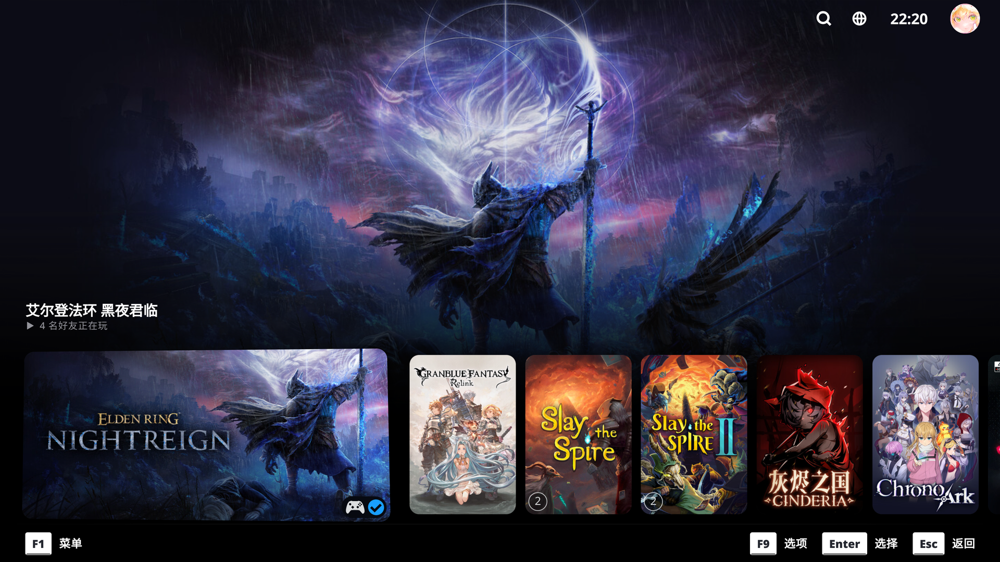
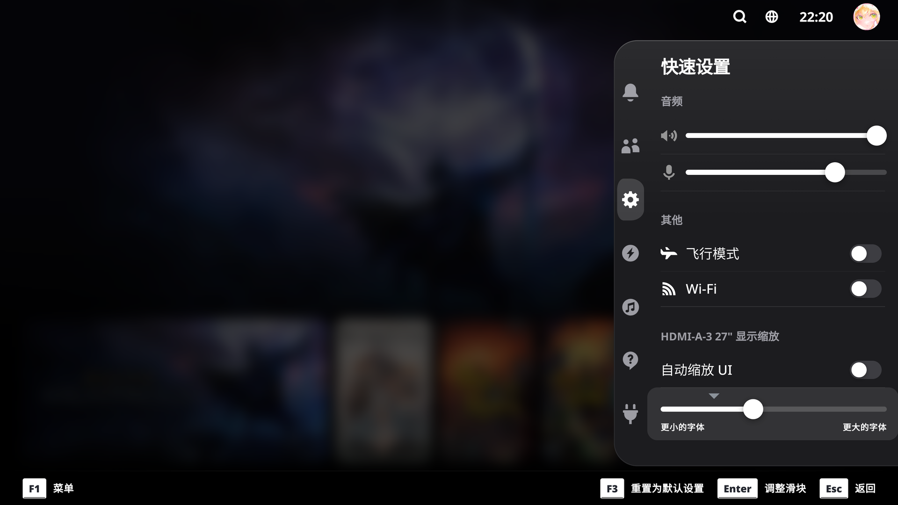
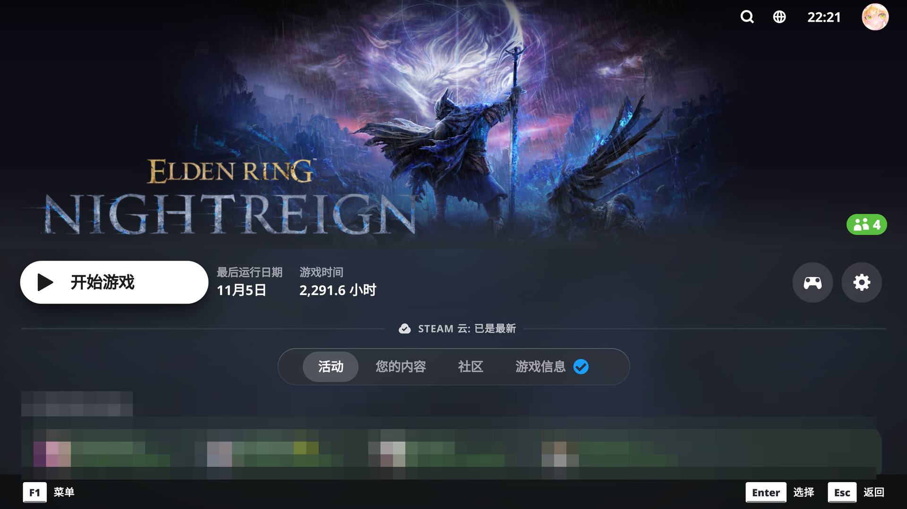

# tvdeck

为 SteamOS 游戏模式（Steam Machine，16:9 / 4K）、Steam Deck 与大屏幕模式提供 Apple TV / tvOS 风格外观。
适用于 CSS Loader（Decky Loader）的主题。

基于 **K€YOZ** 的 **tvOS Deck**（MIT 许可）。

[English README](README.md)

## 截图

## 安装

1. 安装 [Decky Loader](https://decky.xyz) 以及 **CSS Loader** 插件。
2. 把本文件夹复制到 `~/homebrew/themes/tvdeck`（或在 CSS Loader 的主题浏览里安装 “tvdeck”）。
3. 快捷访问（…）→ CSS Loader → 启用 **tvdeck**。
4. 推荐：在 Steam *设置 → 自定义 → 主页 → 大画幅模式（Big Art Mode）* 下使用，以获得 Apple TV 顶栏式主界面。

文件夹名必须保持 `tvdeck`：CSS Loader 按文件夹名提供主题文件。

## 选项

| 选项 | 可选值 | 默认值 |
| --- | --- | --- |
| Focus Effect（焦点效果） | Apple TV (Parallax) · Subtle · Off | Apple TV (Parallax) |
| Background（背景） | Graphite · Black (OLED) · Aurora (tvOS 26) | Graphite |
| Font（字体） | Steam (Motiva Sans) · System font | System font |
| Footer（底栏） | Steam Default · Minimal · Hidden | Steam Default |
| Keyboard Styling（键盘样式） | Yes · No | Yes |
| Reduce Transparency（减少透明） | Yes · No | No |
| Colors（配色） | 强调色、开关色 | `#0A84FF` / `#30D158` |
| Hide friends playing（隐藏好友动态） | Yes · No | Yes |
| Recent Games At Bottom（最近游戏置底） | Yes · No | Yes |
| Fullscreen Recent Games Background（最近游戏全屏背景） | Yes · No | No |
| Titles Above Cards（标题上移） | Yes · No | Yes |

## 说明

- `Titles Above Cards` 会把当前聚焦游戏的标签移到最近游戏卡片上方，并隐藏「Recent Games」页头；
  与 `Recent Games At Bottom` 组合时，卡片行固定在底部，标签随之上移。
- Steam 菜单与快捷访问是独立的覆盖窗口，无法模糊其后的游戏画面，因此使用不透明玻璃底色。
- 主题不自带字体文件。`System font` 解析为 `system-ui, sans-serif`；`Steam (Motiva Sans)` 沿用 Steam 自身的字体栈。
- 非官方粉丝主题，与 Apple、Valve 无关联。

## 致谢

tvdeck 派生自 **K€YOZ** 的 **tvOS Deck**（上游版本 1.1.0，MIT 许可）。上游版权声明保留在
[LICENSE](LICENSE) 中，修改部分由 Honchane 完成。

## Deutsch

Ordner nach `~/homebrew/themes/tvdeck` kopieren, in CSS Loader einschalten und in Steam
*Einstellungen → Anpassung → Startseite → „Große Grafik“* aktivieren.
